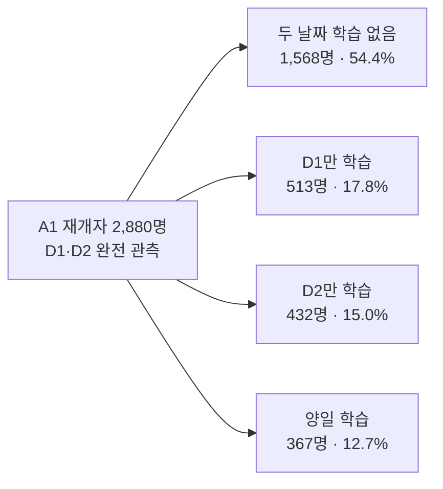

# 행동 흐름과 다음 학습 연결

작성 2026-10-13. 기준 2013-03-01~07 UTC, 추적 03-08~11 UTC. 사용자별 학습 날짜를 분석했다.

**주후보는 하루 이상 학습 기록이 없다가 학습을 재개한 습관 형성형의 다음 학습 연결이다.** 이 집단에서 다음 두 날짜 동안 추가 학습이 관측되지 않은 비율은 54.4%다. 이 수치는 개입으로 개선 가능한 비율을 뜻하지 않는다.

| 고정 기준집단 | 전체 | 추적 학습 없음 | 1일 학습 | 2일 이상 학습 |
|---|---:|---:|---:|---:|
| 전체 | 82,467 | 53,227 (64.5%) | 15,774 (19.1%) | 13,466 (16.3%) |
| 습관 형성형 | 14,583 | 6,975 (47.8%) | 4,046 (27.7%) | 3,562 (24.4%) |

추적 전체에서 하루만 학습했다는 결과는 첫 학습 후 같은 길이의 추적 결과와 다르다. 관측 기회를 맞추기 위해 다음 두 UTC 날짜를 모두 볼 수 있는 3/8·9 첫 학습자를 따로 분석했다.

| 습관 형성형 첫 후속 학습자의 범위 | 두 날짜 관측 인원 | D1·D2 중 추가 학습 | 관측 비율 (개별 95% Wilson CI) |
|---|---:|---:|---|
| 전체 첫 후속 학습자 | 5,679 | 2,704 | 47.6% (46.3~48.9%) |
| 전날에도 학습한 사람 A0 | 2,799 | 1,392 | 49.7% (47.9~51.6%) |
| 직전 완전 날짜 1일 이상 비활동인 재개자 A1 | 2,880 | 1,312 | 45.6% (43.7~47.4%) |

A1의 역사적 후보는 3/8~11 총 4,809명이다. 3/10·11 재개자 1,929명은 두 날짜를 완전히 관측할 수 없어 결과율의 분모에서 제외했다. 운영 실험에서는 충분히 추적한 뒤 모든 배정자를 분모에 포함해야 한다.

별도 후보 B는 두 완전 UTC 날짜가 비활동으로 끝난 직후의 복귀 유도다. 사용자당 최초 자격 1회 기준 11,680명 중 결과 두 날짜가 관측 가능한 9,515명에서 2,147명(22.6%)이 학습했다. A1의 재개 이후 추가 학습과 B의 비활동 이후 복귀는 대상·시점·결과 기간이 다르다.

모든 선정은 당시까지의 기록만 사용했다. 3/11 종료 상태로 과거 대상을 고르지 않았다. 역사적 관측 비율로 개입 효과나 후보의 효과 순위를 판단하지 않는다. 다음 작업은 A1 한 가지를 기준으로 배정·노출·측정 명세를 작성하는 4번이다.

[대상·시점 정의서](C:/Users/USER/OneDrive/마케팅/cohort_v2/behavior_flow/개입대상과_시점_정의서.md)
